# Lab 1: the first integration flow (build, deploy, call)

This lab builds the first integration flow (iFlow) in SAP Integration Suite, deploys it to the Cloud Integration runtime, and calls it over the web with an OAuth token. It returns a small JSON payload. The result is a live, authenticated HTTP endpoint, which is exactly the unit that API Management wraps next and the MCP Gateway exposes after.

Builds on Lab 0 (the tenant must be enabled with the Design and Monitor menus showing).

Runs on the SAP Integration Suite trial, Singapore region.

---

## 1. What an iFlow is

An iFlow is a **pipeline**. A message enters on the left, flows through a series of steps, and leaves on the right. It is a route in a middleware layer: something sends a request in, the iFlow transforms, routes, enriches, or validates it, then returns a response or hands it to a target system.

In system design terms it is a **mediator**. It decouples the caller from the backend, so either side can change without breaking the other, and cross-cutting concerns (mapping, security, error handling, logging) live in one place instead of in every client.

The pieces on the canvas:

- **Sender**: a placeholder for the system that calls the iFlow (inbound).
- **Start / End**: the message events inside the Integration Process. Start is where the request arrives, End is where the reply leaves.
- **Receiver**: a placeholder for a system the iFlow calls out to (outbound). Not used in this lab.
- **Adapters**: the protocol plugs (HTTPS, OData, SOAP) that connect Sender and Receiver to the process.

This lab builds a **synchronous request-reply**: a caller hits an HTTPS endpoint, the iFlow sets a JSON body, and the response goes back to the caller. That synchronous endpoint is what API Management and MCP need later.

---

## 2. Create the package and the iFlow

Integration content lives in an **integration package**, a container for iFlows and other artifacts.

1. Left menu, **Design, Integrations and APIs**.
2. **Create**, name the package `Procurement Integration`, Save.

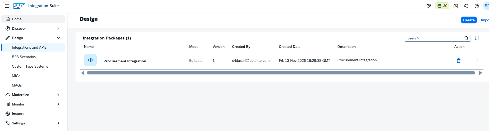

3. Open the package, **Artifacts** tab, **Edit**, **Add, Integration Flow**.
4. Name it `GetPOStatus`, Runtime Profile **Cloud Integration**, **Add and Open in Editor**.

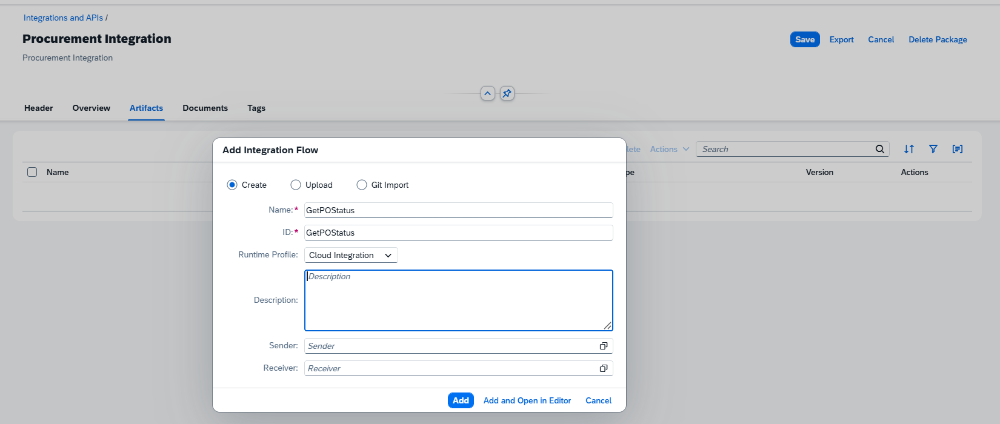

Sender and Receiver are left empty in this dialog. They are only documentation here. The real wiring happens on the canvas, where it is clearer.

The editor opens with an empty process: Sender, an Integration Process box with Start and End, and a Receiver.

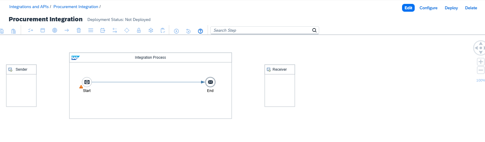

---

## 3. Add the HTTPS sender (the front door)

The iFlow has an inside (Start to End) but no way in yet. Connecting the Sender to Start with an **HTTPS adapter** creates an HTTP endpoint on the runtime that an external caller can hit.

1. Click **Edit** to enter edit mode.
2. Hover over the **Sender** box, a connector arrow appears. Drag from the Sender to the **Start** event.
3. Choose **HTTPS** from the adapter list.

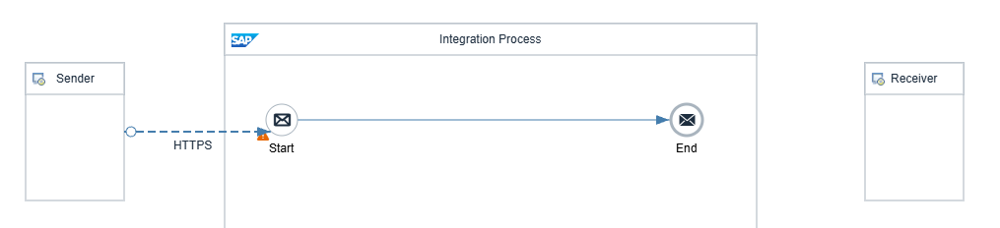

4. Select the HTTPS line. The properties panel is at the **bottom** of the editor (often collapsed, expand it). Open the **Connection** tab.
5. Set **Address** to `/getpostatus`. This becomes part of the endpoint URL.
6. **Uncheck CSRF Protected**. CSRF protection forces a caller to fetch a token before every call, which adds friction with no benefit for a read-only endpoint. It can go back on for write endpoints later.
7. Leave **Authorization: User Role** and **User Role: ESBMessaging.send**. This is the security layer: any caller must authenticate and hold the `ESBMessaging.send` role.

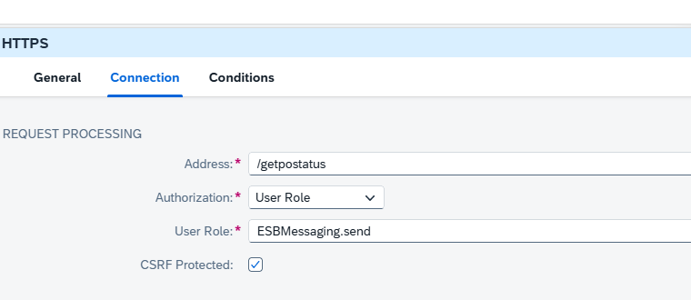

A detour hit along the way: dragging from End to the Receiver by accident adds an HTTP **outbound** adapter, which would make the iFlow call an external system. For a canned response there is no outbound call, so if that happens, select the HTTP line and delete it. The iFlow should be Sender --HTTPS--> Start ----> End, with the Receiver box unconnected.

---

## 4. Return JSON with a Content Modifier

A **Content Modifier** sets or changes the message body and headers. Here it builds the JSON response the caller receives. Without it, the iFlow would return an empty message.

1. Hover over the line **between Start and End**, click the **+** that appears, choose **Message Transformers, Content Modifier**.

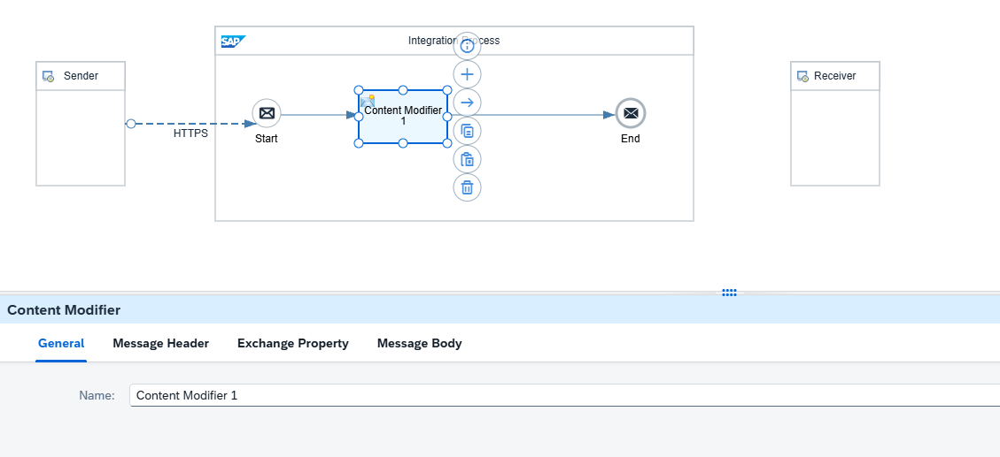

2. Select it, open the **Message Body** tab, set Type to **Constant**, and paste:

```json
{
  "poNumber": "PO-1001",
  "status": "Approved",
  "amount": 15000,
  "currency": "USD",
  "supplierName": "Acme Industrial"
}
```

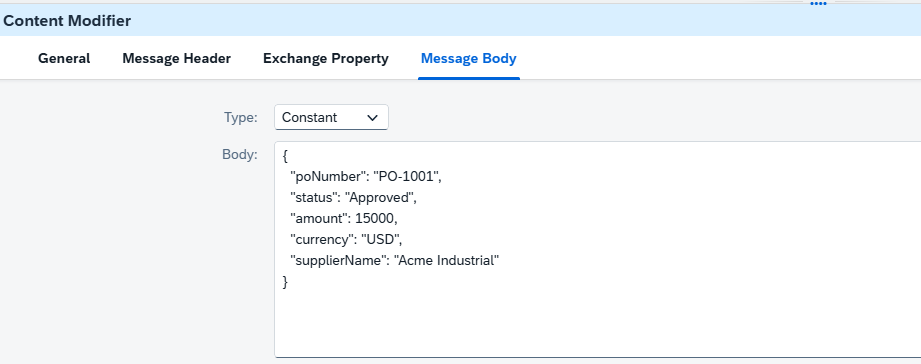

3. Open the **Message Header** tab, **Add** a header: Name `Content-Type`, Source Type **Constant**, Value `application/json`. This makes the runtime return the response as JSON.

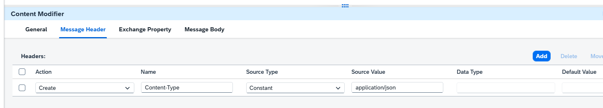

4. **Save**.

This JSON is a stub for now, so the endpoint returns something real to prove the pipeline works. Later it can call the actual CAP service or a backend.

---

## 5. Deploy

Deploying pushes the iFlow to the Cloud Integration runtime and starts it, so the endpoint goes live.

1. **Save**, then **Deploy**, confirm the runtime profile **Cloud Integration**.
2. Wait a minute or two. Refresh the Deployment Status until it shows **Deployed** and Runtime Status **Started** (green).

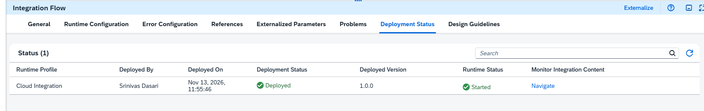

---

## 6. Get the endpoint URL

1. **Monitor, Integrations and APIs**.
2. Under **Manage Integration Content**, click the **Started** tile.
3. Click **GetPOStatus**, open the **Endpoints** tab.

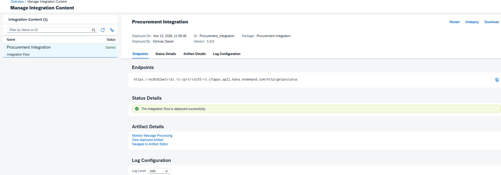

The endpoint:

```
https://ec8c82aetrial.it-cpitrial03-rt.cfapps.ap21.hana.ondemand.com/http/getpostatus
```

The runtime host (`it-cpitrial03-rt...`) is different from the design host. The `/http` prefix plus the `/getpostatus` address make the full URL.

---

## 7. Create credentials to call the endpoint

The endpoint is secured by the `ESBMessaging.send` role, so an anonymous call returns 401. To call it, OAuth client credentials are needed. This is where the **Process Integration Runtime** service instance is finally used, created by hand (the entitlement from Lab 0 is in place, so no booster, no quota error).

1. BTP Cockpit, subaccount, **Instances and Subscriptions, Create**.
2. Service **SAP Process Integration Runtime**, plan **integration-flow**, Runtime Environment **Cloud Foundry**, Space **dev**, name `cpi-caller`, **Create**.

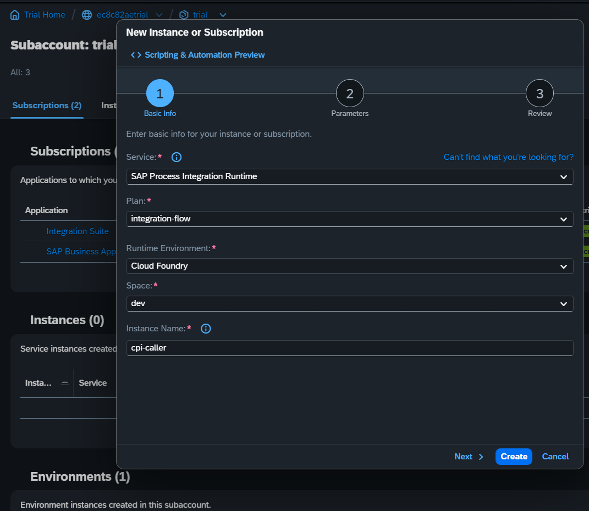

3. Open the instance, **Create Service Key**, name `cpi-caller-key`.
4. The key holds `clientid`, `clientsecret`, `tokenurl`, `url`. **Keep the clientsecret private.**

---

## 8. Call it from the terminal

Run from PowerShell on the laptop (non-SAP tool, so CLI). Use **variables** so the credentials are isolated, because the clientid contains `|` and `!`, which PowerShell mangles inside a plain double-quoted string. Single-quote the values.

```powershell
$turl = 'https://ec8c82aetrial.authentication.ap21.hana.ondemand.com/oauth/token'
$cid  = '<PASTE_CLIENTID>'
$csec = '<PASTE_CLIENTSECRET>'
$tok  = (curl.exe -s -X POST $turl -d 'grant_type=client_credentials' -u "${cid}:${csec}" | ConvertFrom-Json).access_token
$tok.Length
```

`$tok.Length` should print a big number (around 800 to 1200). If it prints **0**, the token step failed. The two usual causes:

1. **Wrong token URL.** Use the key's `tokenurl` (ends in `/oauth/token`), not the runtime `url`.
2. **Special characters in the credentials.** The clientid has `|` and `!`; isolating the values in single-quoted variables fixes it.

Then call the endpoint:

```powershell
curl.exe -X POST 'https://ec8c82aetrial.it-cpitrial03-rt.cfapps.ap21.hana.ondemand.com/http/getpostatus' -H "Authorization: Bearer $tok"
```

Expected output:

```json
{
  "poNumber": "PO-1001",
  "status": "Approved",
  "amount": 15000,
  "currency": "USD",
  "supplierName": "Acme Industrial"
}
```

The JSON came back. The first iFlow works end to end.

### The actual terminal session (including the debugging)

What the PowerShell window looked like, failures and all:

```text
# token came back empty on the first try (the secret pasted was truncated)
PS C:\Users\nivas\repos\sap-ai-journey\sap-ai-journey> $tok.Length
0

# calling with an empty Bearer returns a 500 page, not a 401
PS C:\Users\nivas\repos\sap-ai-journey\sap-ai-journey> curl.exe -X POST 'https://ec8c82aetrial.it-cpitrial03-rt.cfapps.ap21.hana.ondemand.com/http/getpostatus' -H "Authorization: Bearer $tok"
<!doctype html><html lang="en"><head><title>HTTP Status 500 - Internal Server Error</title></head><body><h1>HTTP Status 500 - Internal Server Error</h1></body></html>

# re-run after pasting the FULL secret and confirming the token URL ends in /oauth/token
PS C:\Users\nivas\repos\sap-ai-journey\sap-ai-journey> $tok = (curl.exe -s -X POST $turl -d 'grant_type=client_credentials' -u "${cid}:${csec}" | ConvertFrom-Json).access_token
PS C:\Users\nivas\repos\sap-ai-journey\sap-ai-journey> curl.exe -X POST 'https://ec8c82aetrial.it-cpitrial03-rt.cfapps.ap21.hana.ondemand.com/http/getpostatus' -H "Authorization: Bearer $tok"
{
  "poNumber": "PO-1001",
  "status": "Approved",
  "amount": 15000,
  "currency": "USD",
  "supplierName": "Acme Industrial"
}
```

Reading it: `$tok.Length` of `0` means the token request failed, so the Bearer was empty and the endpoint threw 500 (not 401). The fix was the full client secret plus the correct `/oauth/token` URL. After that the token was valid and the JSON returned.

---

## 9. What the call proved (the architecture)

Reading the flow end to end:

1. The caller exchanged **client credentials** for an **OAuth token** at the authentication server. The token carries the `ESBMessaging.send` role.
2. The caller hit the **HTTPS endpoint** on the Cloud Integration runtime with that token as a Bearer header.
3. The runtime authenticated the token, checked the role, and ran the iFlow: **Start, Content Modifier, End**.
4. The Content Modifier set the JSON body and the `application/json` header, and the End event returned it to the caller.

This is the exact **request-reply, token-secured HTTP endpoint** that the next labs build on. Nothing about the shape changes when API Management wraps it or MCP exposes it; those add a governed door in front of this same call.

---

## 10. Debugging notes worth keeping

- **HTTP 500 with empty message logs** usually means the call did not authenticate cleanly (empty Bearer token), so it never became a real message. Check the token first with `$tok.Length`, not the iFlow.
- **A truncated secret** produces an empty token with no obvious error. Copy the full `clientsecret`.
- **`$tok.Length` is the fastest triage**: a number means the token is good and the problem is in the iFlow; 0 means the problem is the token request.
- **The properties panel lives at the bottom** of the editor and is easy to miss.
- Local SQLite-style stubs aside, this iFlow returns a constant, so it is stable across restarts. The next version can call a live backend.

---

## 11. In production, and the future

This iFlow returns a constant. A production integration flow is a real pipeline.

- **It calls a real backend**, not a Content Modifier. The flow connects to S/4HANA via OData, a database, or an external API, reached through a **Destination**, and through the **Cloud Connector** when the system is on-premise.
- **Real error handling.** An exception subprocess, retries with backoff, dead-letter handling for messages that keep failing, and alerting, not a single happy path.
- **Secured by the enterprise IdP.** The HTTPS sender authenticates against IAS or Azure AD with proper scopes; sensitive payloads may be signed or encrypted.
- **Versioned and transported** dev to test to prod, and monitored in production with alerting on failure rates and latency.

The future shape: this flow becomes a reusable building block that many APIs and agents call, designed once, governed centrally, reused rather than rebuilt. The stub here is the smallest honest version of that pipeline.

---

## 12. Where this sits in the track

- Lab 0: enabling Integration Suite (done).
- **Lab 1: first iFlow, deployed and called (this lab).**
- Lab 2: wrap this endpoint as a managed API in API Management.
- Lab 3: expose that API as an MCP tool through the MCP Gateway, so an AI agent can call it.

The endpoint built here is the thing the agent will eventually reach, through two more layers of governance.
