# Lab 3: expose the API as an MCP Server (the capstone)

This lab turns the managed API from Lab 2 into an MCP Server, a tool an AI agent can discover and call. It closes the whole chain: an MCP client connects, lists the tool, calls it, and gets live SAP data back through the governed gateway. No code, no plugin. Integration Suite has MCP built in.

Builds on Lab 2 (the deployed `GetPOStatusAPI` proxy), Lab 1 (the iFlow), and Lab 0 (the enabled tenant).

Runs on the SAP Integration Suite trial, Singapore region.

---

## 1. What this lab does, in plain terms

Everything built so far was plumbing. Lab 3 hands the API to an AI assistant as a tool.

Think of the chain as a kitchen:
- Lab 1 built the cook (the iFlow that produces the answer).
- Lab 2 put a locked front desk on it (the API proxy).
- Lab 3 gives the menu to an AI assistant, so it can order on its own.

**MCP** (Model Context Protocol) is the common language AI assistants use to call outside tools. An **MCP Server** advertises a tool: "here is `getPOStatus`, call it and I return the purchase order status." After this lab, an agent can be asked in plain English and it calls the tool itself, no curl, no tokens typed by hand.

Key point: Integration Suite provides the MCP Server natively (the artifact type in the Add menu). Nothing to install, unlike the CAP labs where `@cap-js/mcp` was added as a plugin. SAP runs it on the Integration Cell runtime. A client (an MCP-capable agent) still connects from the other side.

---

## 2. Create the MCP Server artifact

In the `Procurement Integration` package, Artifacts, Add, **MCP Server**.

**Step 1, source type**: choose **API**, create an MCP server from an API managed in the tenant. This reuses `GetPOStatusAPI` directly, inheriting its security. That is why Lab 2 came first.

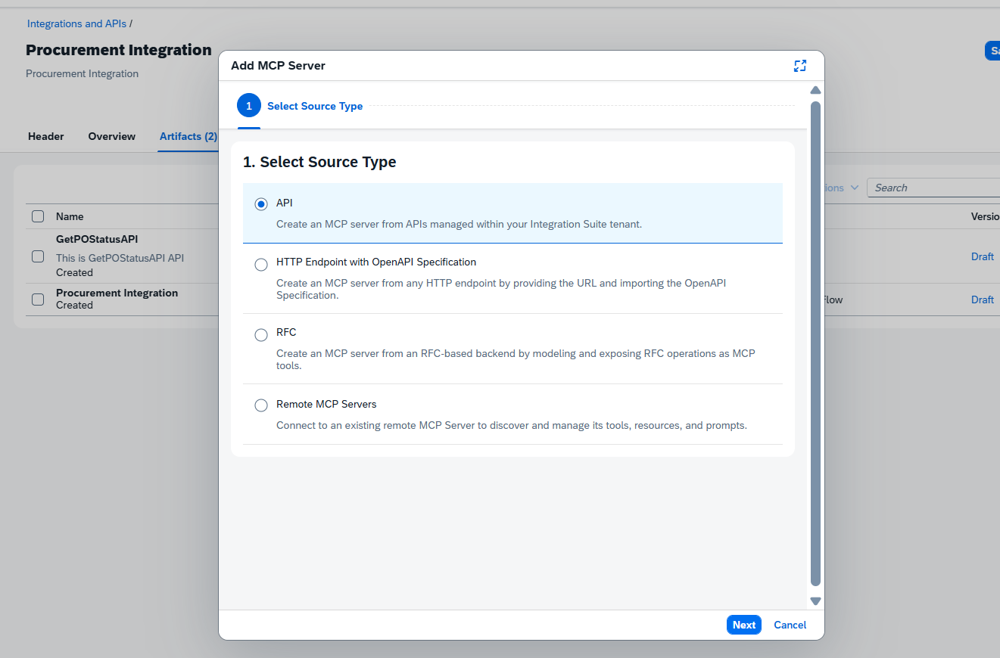

**Step 2, details**: select the API `GetPOStatusAPI`. The name and ID auto-fill. Set:
- MCP Path `/mcp/procurement` (the URL an agent connects to)
- Version `1.0.0`
- Runtime Profile **Integration Cell**

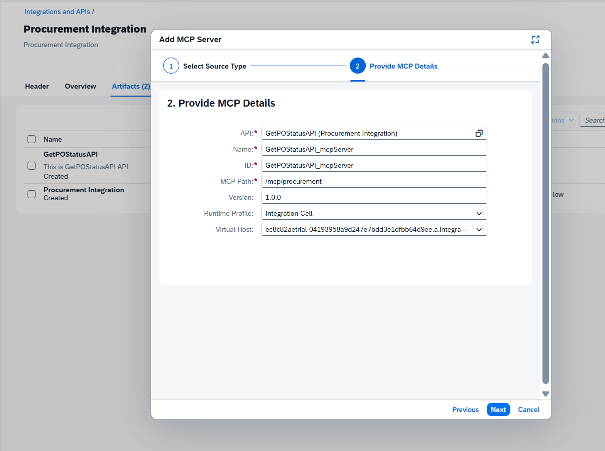

---

## 3. The resource gotcha

**Step 3, Create Tools** showed nothing:

> No tools to display. The selected source does not contain any resources or functions that can be exposed as tools.

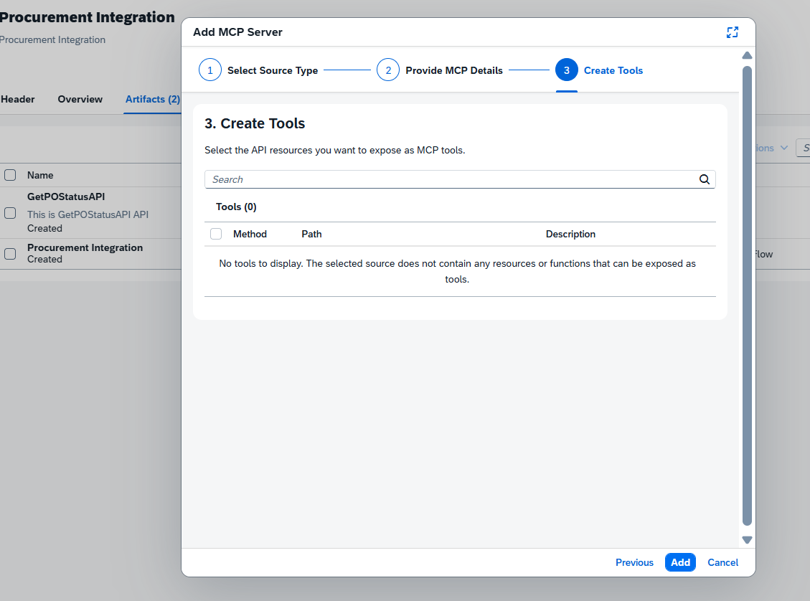

**Root cause**: MCP tools come from an API's **operations (resources)**, and `GetPOStatusAPI` was a bare pass-through with none. The fix is to add one resource to the API first.

Cancel the MCP wizard. On `GetPOStatusAPI`, Edit, **Resources** tab, Add a resource:
- **Tag** `Procurement`
- **Path Prefix** `/` (keeps the tested `/procurement` URL; a sub-path would change where the proxy forwards)
- **Operation** **POST** only (remove the other methods)
- **Description**: `Returns the status, amount, currency and supplier of a purchase order`

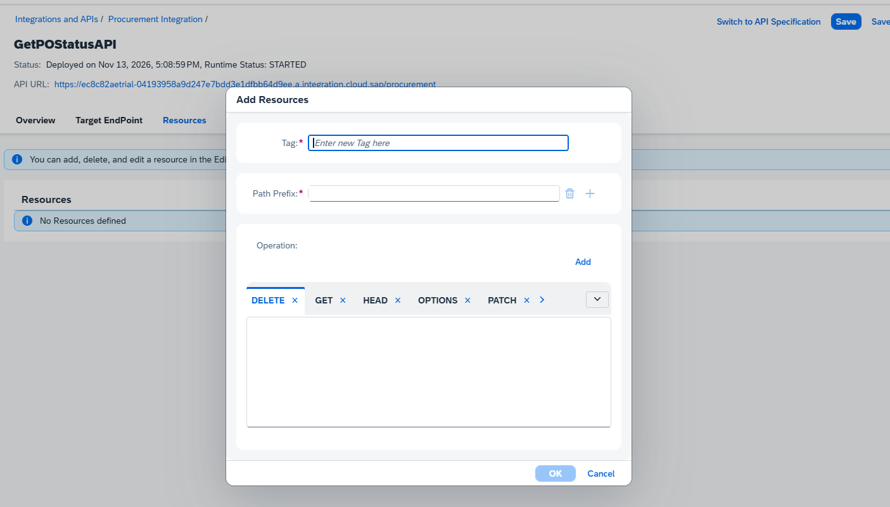

The description matters: it is what the AI agent reads to decide when to call the tool, so write it plainly.

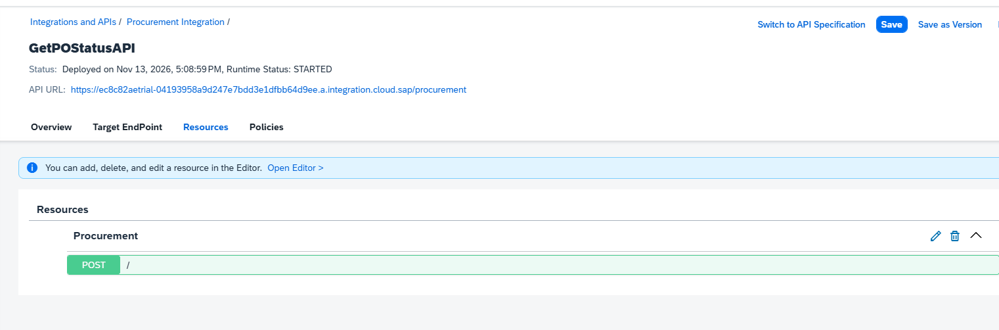

Save and **Deploy** the API, then redo the MCP Server wizard.

---

## 4. The tool appears

With the resource in place, the Create Tools step now lists the operation:

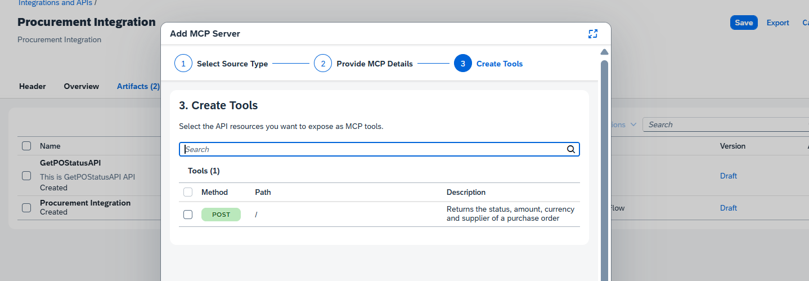

Tick the **POST /** tool and finish. The MCP Server artifact is created in the package, alongside the iFlow and the API.

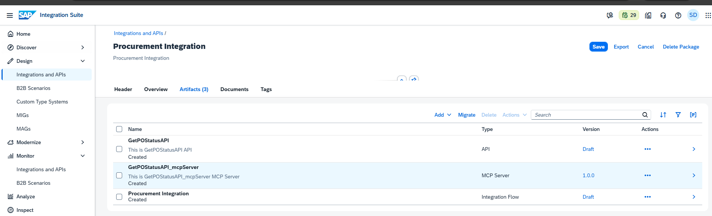

Deploy it (Integration Cell). The MCP endpoint goes live:

```
https://ec8c82aetrial-04193958a9d247e7bdd3e1dfbb64d9ee.a.integration.cloud.sap/mcp/procurement
```

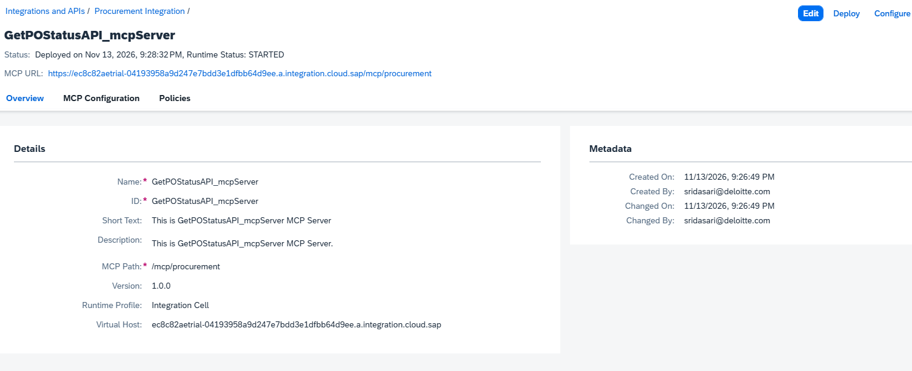

---

## 5. Connect an MCP client (Inspector v2)

The MCP Inspector is the quickest client to verify. Note it was redesigned since the CAP labs: those used **v1.x** (a single connection pane), this is **v2.15.0** (a Servers dashboard with cards and a per-server settings panel). Same job, different layout.

First, set the three variables used to fetch the token. These come from the `cpi-caller-key` service key created in Lab 1 (BTP Cockpit, the subaccount, Instances and Subscriptions, the `cpi-caller` instance, its service key). Set them once in the terminal, pasting the key values inside the single quotes:

```powershell
$turl = 'https://ec8c82aetrial.authentication.ap21.hana.ondemand.com/oauth/token'
$cid  = '<CLIENT_ID from cpi-caller-key>'
$csec = '<CLIENT_SECRET from cpi-caller-key>'
```

Single quotes matter: the client id contains `|` and `!`, which PowerShell mangles inside double quotes.

Then generate a fresh inbound token:

```text
PS C:\Users\nivas\repos\sap-ai-journey\sap-ai-journey> $tok = (curl.exe -s -X POST $turl -d 'grant_type=client_credentials' -u "${cid}:${csec}" | ConvertFrom-Json).access_token
PS C:\Users\nivas\repos\sap-ai-journey\sap-ai-journey> $tok
eyJqa3UiOiJodHRwcz...  (JWT access token, redacted; expires in ~1 hour)  ...1Iw
```

Check `$tok.Length` prints a big number (around 1180). If it prints `0`, the token request failed, re-check the three variables (the token URL ends in `/oauth/token`, and the secret is the full value with no typo).

The decoded token carries the scopes `...API.invoke` and `...ESBMessaging.send`, exactly what the inbound layer needs.

Then launch the Inspector:

```text
PS C:\Users\nivas\repos\sap-ai-journey\sap-ai-journey> npx @modelcontextprotocol/inspector@latest
Need to install the following packages:
@modelcontextprotocol/inspector@2.15.0
Ok to proceed? (y) y
Starting MCP inspector...

MCP Inspector Web is up and running at:
   http://127.0.0.1:6274?MCP_INSPECTOR_API_TOKEN=<local session token>

   Sandbox (MCP Apps): http://127.0.0.1:6275/sandbox

   Auth token: <local session token>

Opening browser...
```

It opens the browser UI.

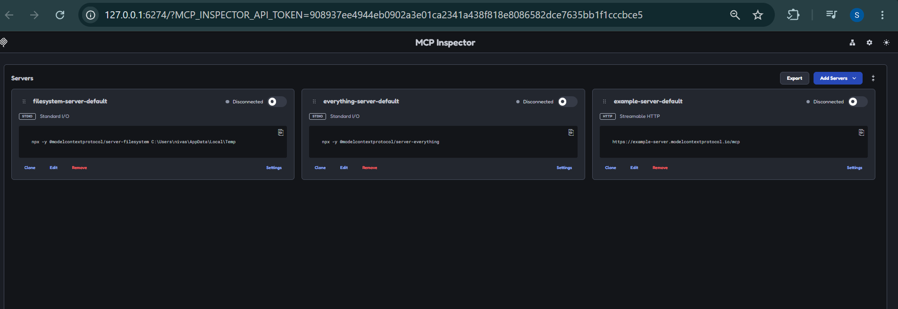

Add the server: **Add Servers, Add manually**, then:
- **Server ID** `procurement-mcp`
- **Transport** **streamable-http**
- **URL** `https://ec8c82aetrial-04193958a9d247e7bdd3e1dfbb64d9ee.a.integration.cloud.sap/mcp/procurement`

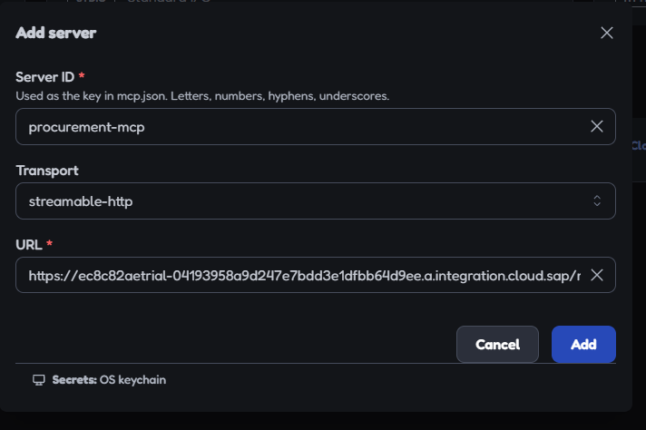

The server inherits the API's inbound OAuth, so the client must present the token generated above. In the server's **Settings, Custom Headers**, add:
- Name `Authorization`
- Value `Bearer <paste the token>` (the `Bearer ` prefix matters)

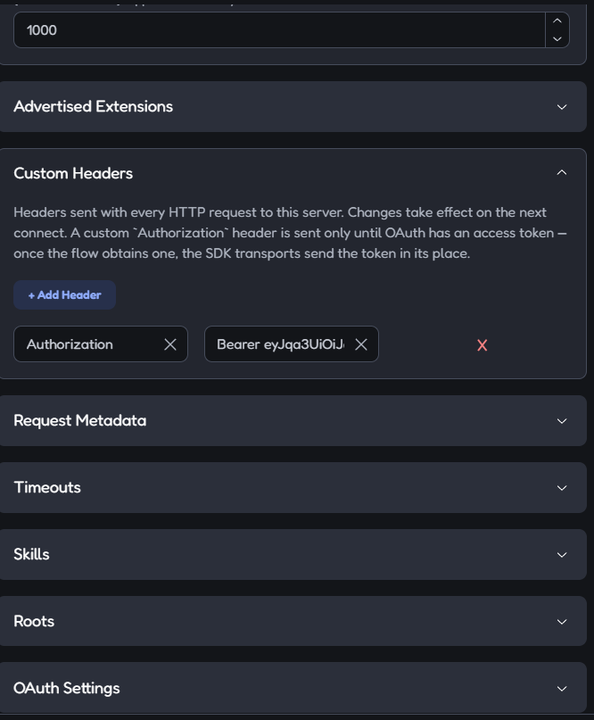

Close Settings and toggle **Connect**.

---

## 6. It works end to end

On connect, the protocol log shows **TOOLS/LIST OK**: the handshake and tool discovery succeeded over OAuth.

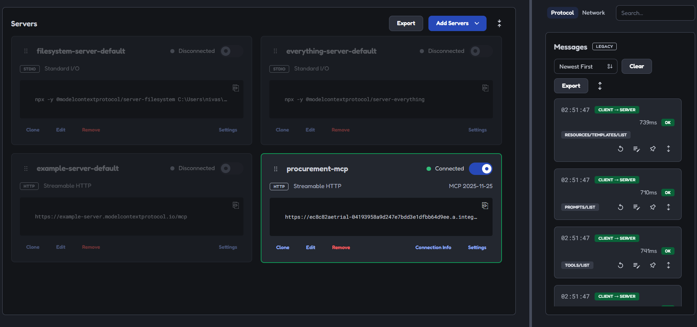

The **Tools** tab lists `getPOStatus` with its description.

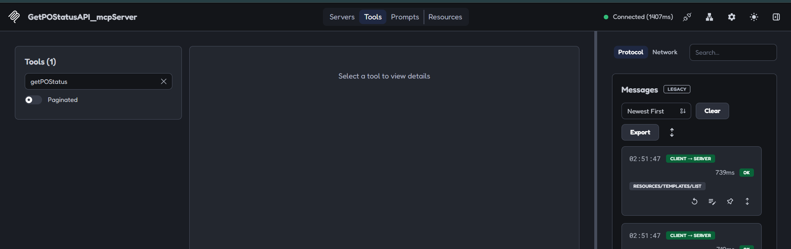

Select it, enter `{}` as the payload (the stub ignores it), and **Execute Tool**. The result:

```json
{
  "poNumber": "PO-1001",
  "status": "Approved",
  "amount": 15000,
  "currency": "USD",
  "supplierName": "Acme Industrial"
}
```

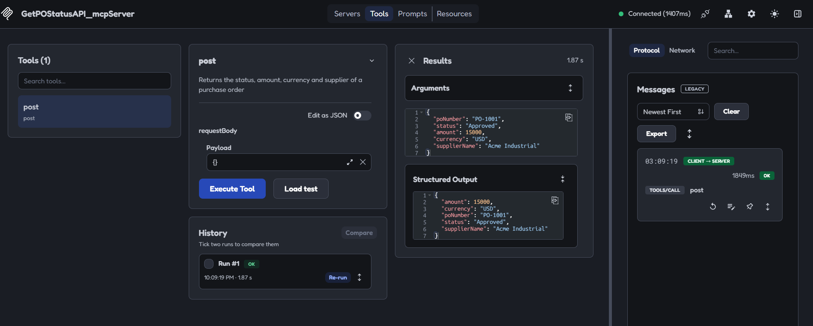

An MCP client just called real SAP data through the entire governed chain.

---

## 7. The full architecture

Reading the chain end to end:

```
MCP client (agent)
  → MCP Server  /mcp/procurement   (presents inbound OAuth token)
  → GetPOStatusAPI                  (validates the token)
  → proxy fetches its own backend token (cpi-oauth-cred)
  → iFlow                           (checks ESBMessaging.send, runs)
  → JSON, back up the chain
```

The agent holds only the inbound token. It never sees the API's backend secret or the iFlow's security. This is the SAP-native equivalent of the CAP MCP labs: an AI agent reaching live SAP data through a governed gateway. It is exactly the pattern enterprises want for agentic AI on SAP.

---

## 8. Honest note: this is the plumbing, not yet the intelligence

The tool returned a **fixed** PO-1001 because the iFlow is a **stub** (its Content Modifier returns a constant). That is why the empty payload still worked. What this lab proves is the **secure pipeline**, not a live lookup.

A real use case would add three things on top:
- **The iFlow**: accept a `poNumber` input and query a real backend (S/4HANA via OData, a CAP service, or a database) for that PO. The CAP labs' `checkPOStatus` already did this against a database.
- **The tool**: declare `poNumber` as an input parameter, so the agent knows to pass it.
- **The agent**: a real MCP client (Claude Desktop, Joule) that fills the parameter from a plain-English question like "Is PO-1003 approved?"

Today's lab is the secure highway. The dynamic lookup and the plain-English asking are the next layer, and smaller now that the hard part is proven.

---

## 9. Gotchas worth keeping

- **An API needs a resource (operation) before MCP can expose a tool.** A bare pass-through proxy shows "No tools to display." Add a resource with a clear description first.
- **The resource description becomes the tool description**, which is what the agent reads to decide when to call it. Write it for an AI, not for a human reader.
- **Path Prefix `/`** keeps the tested URL. A sub-path changes where the proxy forwards and can 404 the backend.
- **The MCP Server inherits the API's inbound OAuth.** The client presents a Bearer token in a Custom Header; the `Bearer ` prefix is required.
- **Inspector v2 differs from v1**: a Servers dashboard and a per-server Settings panel (Custom Headers, Protocol Era) instead of one pane. The workflow is the same.
- **No install needed.** Integration Suite's MCP Server is native, unlike the CAP `@cap-js/mcp` plugin.

---

## 10. In production, and the future

The Inspector was a stand-in client. Production swaps it for real agents and real governance.

- **The client is a registered agent**, SAP Joule, an enterprise copilot, or a custom agent, each its own OAuth client with its own identity and a **scoped** set of tools, not a shared trial token pasted into a test UI.
- **Tools are parameterized and call live data** (the dynamic version), and any tool that **writes** sits behind human-in-the-loop confirmation, an agent proposes, a person approves.
- **Published in Developer Hub**, discoverable, documented and versioned, so agents and developers find tools through a catalog rather than a shared URL.
- **Every agent tool call is audit-logged** for governance and compliance, who called what, when, with what result, which is non-negotiable once AI agents touch business data.

The future shape: the SAP Enterprise AI Gateway announced at TechEd 2026 is exactly this at enterprise scale, one governed gateway where every agent has a registered identity, scoped tools, per-agent quotas, and a full audit trail. These labs are the hand-built version of that gateway.

---

## 11. Where this sits in the track

- Lab 0: enabling Integration Suite.
- Lab 1: first iFlow.
- Lab 2: managed API, OAuth both ways.
- **Lab 3: MCP Server, called by an MCP client (this lab, the capstone).**
- Lab 4 (next): the dynamic version, a `poNumber` input, a real lookup, and a live agent asking in plain English.

With this, the Integration Suite MCP track mirrors the CAP MCP track, through the SAP-native gateway instead of a CAP plugin.
